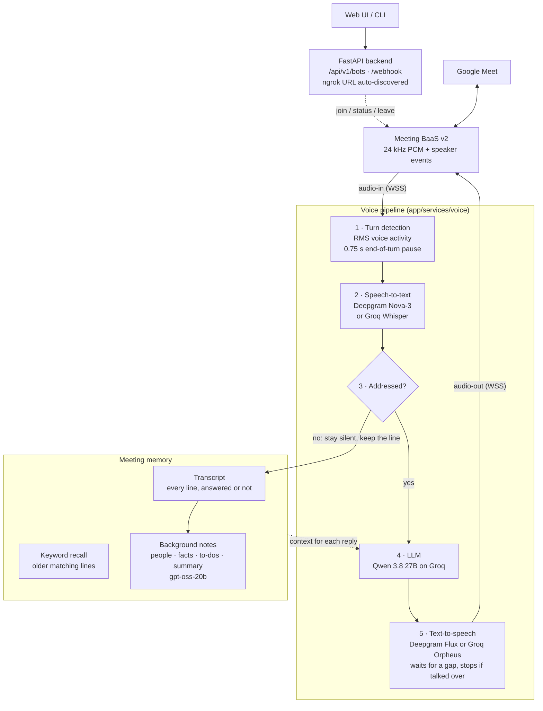

# Real-Time Google Meet AI Agent

An AI participant that joins a Google Meet, listens in real time, and talks like a person in the room. It speaks only when it's addressed, handles follow-up questions, stays quiet when people are just talking about it, and remembers everything said in the meeting.



Full write-up: [docs/architecture.md](docs/architecture.md)

---

## What it does

- **Joins a Google Meet** from a web UI or the CLI, waits to be admitted, then greets the room.
- **Knows when it's being spoken to.** It answers when called by name (including names the transcriber gets slightly wrong) and handles follow-up questions without the name. It stays silent when people only mention it or talk to each other.
- **Takes turns like a person.** It waits for the speaker to finish (0.75 s pause), holds its reply while someone else is talking, and stops mid-sentence if someone talks over it.
- **Remembers the meeting.** A full transcript, keyword recall of older lines, and running notes (people, facts, action items, summary) written in the background by a small model, so replies never wait on it.
- **Works with other AI agents** (e.g. Boardy) in the same call, with a guard that stops bot-to-bot loops.
- **Survives a server restart** mid-call: session metadata and notes persist in `.runtime/`.

## Stack

| Stage | Default | Alternative (`USE_GROQ=true`) |
|---|---|---|
| Meeting bridge | Meeting BaaS v2 (live 24 kHz PCM over WebSockets) | Meeting BaaS hosted Speaking Bot (GPT-4o-mini + Cartesia), selectable in the UI |
| Speech-to-text | Deepgram Nova-3 | Groq Whisper `whisper-large-v3-turbo` |
| LLM | Qwen `qwen/qwen3.8-27b` on Groq | same |
| Text-to-speech | Deepgram Flux, streamed | Groq Orpheus |
| Meeting notes | `openai/gpt-oss-20b` on Groq | same |
| Backend | FastAPI + Uvicorn, Python 3.12, `uv` | |

---

## Quick start

### 1. Install and configure

```bash
uv sync
cp .env.example .env   # then fill in your keys
```

You need keys for **Meeting BaaS**, **Groq** and **Deepgram** (Deepgram isn't needed if `USE_GROQ=true`), plus [ngrok](https://ngrok.com/) installed.

### 2. Start the server

```bash
make server          # or: uv run uvicorn main:app --reload --port 8000
```

- Web UI: http://localhost:8000/
- API docs: http://localhost:8000/docs
- Health check: http://localhost:8000/health

### 3. Start ngrok (second terminal)

```bash
make ngrok           # or: ngrok http 8000
```

You don't need to copy the ngrok URL anywhere. The backend reads it from ngrok's local API (`127.0.0.1:4040`) every time it sends a bot. On Windows, `make dev` opens ngrok in a new window and starts the server in one step.

### 4. Send the agent to a call

**Web UI:** open http://localhost:8000/, paste the Meet link, click **Send Agent to Call**, then **Admit** the agent in Google Meet.

**CLI:**

```bash
make cli URL=https://meet.google.com/xxx-yyyy-zzz
```

Press `s` for live status and `q` to make the bot leave.

Then talk to it by name, e.g. *"Jarvis, what did we decide about the launch date?"*

---

## Configuration (`.env`)

See [`.env.example`](.env.example) for every option. The main ones:

| Variable | Purpose |
|---|---|
| `MEETING_BAAS`, `MEETING_BAAS_WEBHOOK` | Meeting BaaS API key and webhook secret |
| `GROQ_API_KEY` | LLM and meeting notes (also speech when `USE_GROQ=true`) |
| `DEEPGRAM_API_KEY` | Speech-to-text and text-to-speech (default engines) |
| `USE_GROQ` | `false` = Deepgram speech (default), `true` = Groq Whisper + Orpheus |
| `DEFAULT_BOT_NAME`, `DEFAULT_ENTRY_MESSAGE` | Agent name and greeting (can also be set per call in the UI) |
| `OTHER_AI_PARTICIPANTS` | Other AI agents in the call, e.g. `Memorae,Boardy` |
| `BOT_NAME_ALIASES` | Extra spellings of the bot's name the transcriber may produce |
| `MEMORY_NOTES_ENABLED`, `MEMORY_NOTES_MODEL` | Background meeting notes |
| `WEBHOOK_URL` | Optional fixed public URL; leave blank for ngrok auto-discovery |

The agent's personality and rules live in [`app/prompts/system_prompt.md`](app/prompts/system_prompt.md). Context about the meeting (who built it, who's in the call) goes in [`app/prompts/briefing.md`](app/prompts/briefing.md). Both are re-read at the start of every session, so you don't need to restart after editing them.

---

## Project structure

```text
memorae-task/
├── app/
│   ├── api/v1/
│   │   ├── endpoints/
│   │   │   ├── bots.py            # POST /bots/join, GET + DELETE /bots/{bot_id}
│   │   │   ├── streaming.py       # audio-in / audio-out WebSockets
│   │   │   └── webhooks.py        # Meeting BaaS status webhooks
│   │   └── router.py
│   ├── core/                      # config (.env), logger, typed exceptions
│   ├── helpers/meeting.py         # Google Meet URL cleaning
│   ├── models/, schemas/          # Pydantic models and request/response schemas
│   ├── prompts/
│   │   ├── system_prompt.md       # personality, spoken style, turn-taking rules
│   │   ├── briefing.md            # meeting-specific context
│   │   └── loader.py
│   ├── services/
│   │   ├── voice/                 # real-time voice pipeline
│   │   │   ├── stream_handler.py  #   audio in/out, turn detection, greeting
│   │   │   ├── turn_handler.py    #   one turn: STT -> gate -> LLM -> TTS
│   │   │   ├── stt.py             #   Deepgram / Groq Whisper
│   │   │   ├── addressing.py      #   "is it talking to me?" gate
│   │   │   ├── llm.py             #   Qwen on Groq
│   │   │   ├── tts.py             #   Deepgram Flux / Groq Orpheus, barge-in
│   │   │   ├── memory_notes.py    #   background meeting notes
│   │   │   └── session*.py        #   per-call state, restart recovery
│   │   ├── meeting_memory.py      # transcript, recall, notes -> LLM context
│   │   ├── meeting_baas.py        # Meeting BaaS API (join, status, leave)
│   │   ├── groq_voice_pipeline.py # facade used by the API layer
│   │   ├── session_store.py       # live bot status
│   │   └── usage_monitor.py       # background status/usage logging
│   └── templates/index.html       # web UI
├── docs/                          # architecture write-up and diagram
├── cli.py                         # terminal client
├── main.py                        # FastAPI entrypoint
└── Makefile
```

---

## Next steps for production

- **Lower latency:** stream speech-to-text and the LLM end to end, and join meetings faster (Recall AI or a custom meeting bot).
- **Persistent memory:** Postgres + pgvector or mem0, so the agent remembers people across meetings.
- **Actions:** tools for reminders and follow-ups.
