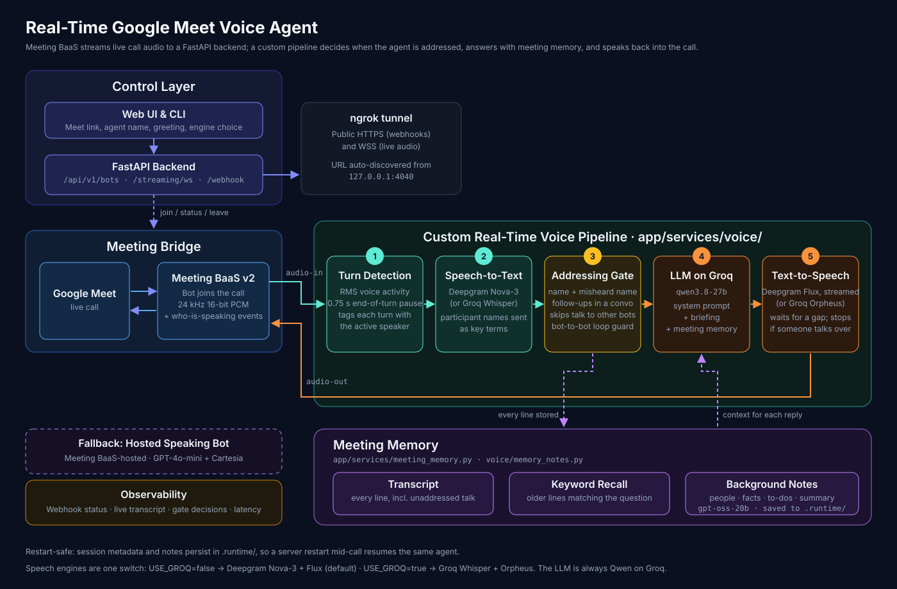

# Real-Time Google Meet Voice Agent: Architecture

An AI participant that joins a Google Meet, listens in real time, speaks only when it is addressed, and remembers everything said in the meeting.

---

## How a turn flows

1. **Dispatch.** The Web UI or CLI calls `POST /api/v1/bots/join`. The backend finds the active ngrok URL automatically (local API on `:4040`) and asks Meeting BaaS to join the call with live audio streaming turned on.
2. **Join and greet.** Meeting BaaS opens two WebSockets to the backend: `/streaming/ws/audio-in/{session_id}` (call audio in) and `/streaming/ws/audio-out/{session_id}` (agent's voice out). The agent waits until it is admitted, then says its greeting.
3. **Detect a turn.** Incoming 24 kHz PCM goes through an RMS voice-activity check. A turn ends after a 0.75 s pause. Meeting BaaS speaker events tag each turn with the person who said it.
4. **Transcribe.** Deepgram Nova-3 (default) or Groq Whisper converts the turn to text. Participant names are passed to the transcriber as key terms so names come out right.
5. **Decide whether to answer.** The addressing gate (`voice/addressing.py`) answers when:
   - the agent is called by name, including common misspellings by the transcriber,
   - the same person keeps talking to it within 30 s (follow-up questions without the name), or
   - someone addresses the whole group.

   It stays silent when people only mention it, talk to each other, or talk to another AI agent (`OTHER_AI_PARTICIPANTS`). A loop guard caps back-to-back bot-to-bot replies. Every line it doesn't answer still goes into memory.
6. **Think.** Qwen (`qwen/qwen3.8-27b`) on Groq gets the system prompt, the briefing, and the meeting memory, then writes a short reply in plain spoken English, or `[SILENCE]` if it shouldn't speak.
7. **Speak.** Deepgram Flux (streamed, default) or Groq Orpheus turns the reply into audio, sent back in 20 ms chunks. The agent waits for a gap if someone is talking, and stops mid-sentence if someone talks over it for more than 1 s.

Each turn logs its stages to the terminal: transcript, gate decision, and STT / LLM / TTS latency.

---

## Components

| Layer | Technology | Role | Code |
|---|---|---|---|
| UI and CLI | HTML + Tailwind, Python CLI | Meet link, agent name, greeting, engine choice | [`app/templates/index.html`](../app/templates/index.html), [`cli.py`](../cli.py) |
| Backend | FastAPI + Uvicorn (Python 3.12, `uv`) | Bot lifecycle (`POST /api/v1/bots/join`, `GET` / `DELETE /api/v1/bots/{bot_id}`), webhooks, audio WebSockets | [`main.py`](../main.py), [`app/api/v1/`](../app/api/v1/) |
| Tunnel | ngrok, auto-discovered | Public HTTPS for webhooks and WSS for audio, no hardcoded URLs | [`app/services/meeting_baas.py`](../app/services/meeting_baas.py) |
| Meeting bridge | Meeting BaaS v2 | Joins Google Meet, streams 24 kHz 16-bit PCM and who-is-speaking events, plays the agent's audio | [`app/services/meeting_baas.py`](../app/services/meeting_baas.py) |
| Turn detection | Custom RMS VAD | Speech vs. silence, 0.75 s end-of-turn pause, speaker tracking | [`voice/stream_handler.py`](../app/services/voice/stream_handler.py) |
| Speech-to-text | Deepgram Nova-3 / Groq Whisper | Transcribes each turn, using participant names as key terms | [`voice/stt.py`](../app/services/voice/stt.py) |
| Addressing gate | Custom rules | Name and misheard-name detection, follow-ups, other-bot awareness, loop guard | [`voice/addressing.py`](../app/services/voice/addressing.py) |
| LLM | Qwen 3.8 27B on Groq | Short, speakable replies, or `[SILENCE]` | [`voice/llm.py`](../app/services/voice/llm.py), [`app/prompts/`](../app/prompts/) |
| Text-to-speech | Deepgram Flux (streamed) / Groq Orpheus | Speaks the reply; waits for a gap; stops when talked over | [`voice/tts.py`](../app/services/voice/tts.py) |
| Meeting memory | In-process + background notes | Transcript, keyword recall, running notes (see below) | [`meeting_memory.py`](../app/services/meeting_memory.py), [`voice/memory_notes.py`](../app/services/voice/memory_notes.py) |
| Fallback engine | Meeting BaaS hosted Speaking Bot | GPT-4o-mini + Cartesia, selectable in the UI | [`app/services/meeting_baas.py`](../app/services/meeting_baas.py) |

`USE_GROQ` switches the speech engines only: `false` (default) uses Deepgram Nova-3 + Flux, and `true` uses Groq Whisper + Orpheus. The LLM is always Qwen on Groq.

---

## Meeting memory

Every reply is built from three layers, so prompt size stays roughly flat however long the meeting runs:

1. **Notes.** A small model (`openai/gpt-oss-20b` on Groq, separate rate limit) rewrites running notes in the background every 8 new lines or after 20 s of quiet: people, facts, action items, and a summary. Notes never block a reply.
2. **Recall.** Older lines that share keywords with the current question, so exact wording from early in the call is still reachable.
3. **Recent.** Every line not yet folded into the notes, plus the last few lines, word for word. Nothing is dropped until the notes cover it.

Memory is passed to the model as tagged reference data, never as instructions. Notes and session metadata are saved to `.runtime/`, so a server restart mid-call picks up the same agent and its notes.

---

## Prompts

- [`app/prompts/system_prompt.md`](../app/prompts/system_prompt.md): personality, spoken-style rules, and turn-taking rules. `{bot_name}` is filled in at load time.
- [`app/prompts/briefing.md`](../app/prompts/briefing.md): context for this meeting (who built the agent, who is in the call), appended when present.

Both are re-read from disk at the start of each session, so editing them doesn't need a restart.

---

## Production next steps

- **Latency:** stream speech-to-text and the LLM end to end, and join meetings faster (Recall AI or a custom meeting bot).
- **Persistent memory:** Postgres + pgvector or mem0, so the agent remembers people across meetings.
- **Actions:** tools for reminders and follow-ups.
