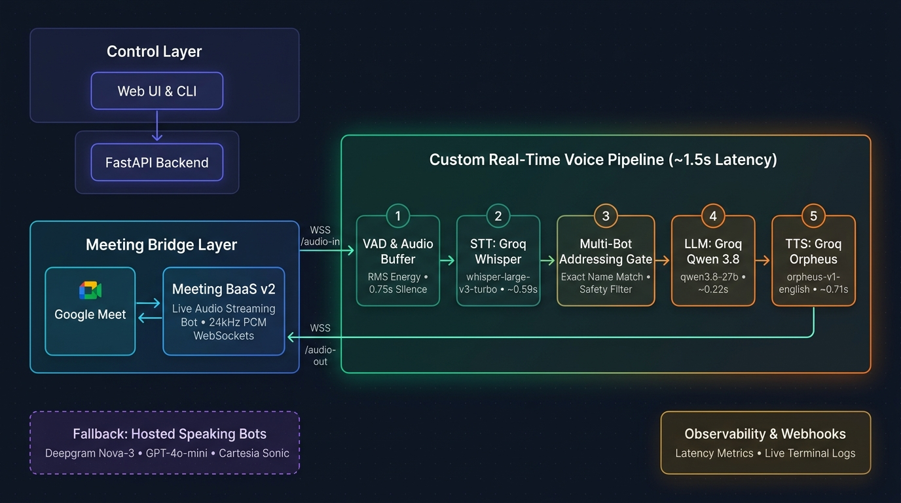

# Memorae / Memo — Real-Time Google Meet AI Agent Architecture

---

## Tool-by-Tool Architecture Breakdown

| Layer / Stage | Tool / Technology | Exact Role in Our System | Code Location |
|---|---|---|---|
| **1. User Interface & CLI** | **HTML + Tailwind CSS** / **Python CLI** | Enter Google Meet URL, Agent Name, Greeting, and switch between **Groq Stack** and **Hosted Speaking Bot**. | [`app/templates/index.html`](../app/templates/index.html), [`cli.py`](../cli.py) |
| **2. Backend API & WebSockets** | **FastAPI + Uvicorn** (`Python 3.12`, `uv`) | Manages bot lifecycle (`POST /api/v1/bots/join`, `GET /api/v1/bots/{bot_id}`, `DELETE /api/v1/bots/{bot_id}`), hosts `/webhook`, and runs the bidirectional audio WebSockets. | [`main.py`](../main.py), [`app/api/v1/endpoints/streaming.py`](../app/api/v1/endpoints/streaming.py) |
| **3. Public Tunneling** | **ngrok** (Auto-Discovered via `:4040`) | Exposes local port `8000` over public `HTTPS` (webhooks) and `WSS` (live audio streams) with zero hardcoded URLs. | [`app/services/meeting_baas.py`](../app/services/meeting_baas.py) |
| **4. Meeting Join & Live Streaming** | **Meeting BaaS v2 API** (`streaming_enabled: true`) | Joins **Google Meet** as a live participant, streams raw **24kHz 16-bit PCM** meeting audio to `/streaming/ws/audio-in/{session_id}`, and injects synthesized AI speech back via `/streaming/ws/audio-out/{session_id}`. Configured with `allow_multiple_bots: true` and `ignored_participant_names`. | [`app/services/meeting_baas.py`](../app/services/meeting_baas.py) |
| **5. Voice Activity Detection (VAD)** | **Custom RMS Energy VAD** | Detects speech vs. silence in incoming 24kHz PCM frames, waits for a `0.75s` end-of-sentence pause to prevent mid-sentence cutoffs, and mutes inbound audio while the bot speaks (echo prevention). | [`app/services/groq_voice_pipeline.py`](../app/services/groq_voice_pipeline.py) |
| **6. Speech-to-Text (STT)** | **Groq Whisper** (`whisper-large-v3-turbo`) | Transcribes buffered 24kHz WAV speech segments into English text in **~0.59s**. | [`app/services/groq_voice_pipeline.py`](../app/services/groq_voice_pipeline.py) |
| **7. Multi-Bot Addressing Gate** | **Strict Explicit Wake-Name Gate + Passive Room Memory** | Ensures the bot **only** replies when explicitly called by exact whole-word name (`\b{bot_name}\b`), guards against `Memorae`/`Memo ray`/`Boardy` collisions, and passively stores the last 6 overheard utterances for context without calling the LLM. | [`app/services/groq_voice_pipeline.py`](../app/services/groq_voice_pipeline.py) |
| **8. AI Brain & Persona** | **Groq Qwen 3.8** (`qwen/qwen3.8-27b`) + Markdown Prompt | Generates concise, TTS-safe 1–2 sentence spoken answers in **~0.22s**. Outputs `[SILENCE]` on third-person mentions (e.g., *"I built memo with FastAPI"*) so it never interrupts human conversations. | [`app/prompts/system_prompt.md`](../app/prompts/system_prompt.md), [`app/prompts/loader.py`](../app/prompts/loader.py) |
| **9. Text-to-Speech (TTS)** | **Groq Orpheus** (`canopylabs/orpheus-v1-english`, voice `autumn`) | Synthesizes natural spoken audio in native **24kHz WAV** (**~0.71s**) — zero resampling overhead — streamed back to Google Meet in real-time 20ms PCM chunks. | [`app/services/groq_voice_pipeline.py`](../app/services/groq_voice_pipeline.py) |
| **10. Built-In Fallback Engine** | **Meeting BaaS Hosted Speaking Bots** | One-click toggle fallback using **Deepgram Nova-3** (STT) + **OpenAI GPT-4o-mini** (LLM) + **Cartesia Sonic** (TTS) if ever needed during a live demo. | [`app/services/meeting_baas.py`](../app/services/meeting_baas.py) |
| **11. Observability & Latency** | **Direct Terminal Logs + Webhooks** | Prints real-time status events (`in_call_recording`, `ended`), live transcripts, addressing-gate decisions, and per-stage latency (`STT + LLM + TTS = First Audio ~1.5s`). | [`app/api/v1/endpoints/webhooks.py`](../app/api/v1/endpoints/webhooks.py), [`app/services/usage_monitor.py`](../app/services/usage_monitor.py) |

---

## Real-Time Audio Flow Summary

1. **Dispatch:** User enters a Google Meet link in the Web UI or CLI → FastAPI auto-discovers the active `ngrok` `WSS`/`HTTPS` URL and calls `POST https://api.meetingbaas.com/v2/bots` with `streaming_enabled: true`.
2. **Join & Greet:** Meeting BaaS joins Google Meet, opens `/streaming/ws/audio-out/{session_id}` and `/streaming/ws/audio-in/{session_id}`, and speaks the entry greeting via Groq Orpheus TTS.
3. **Listen & Gate:** Incoming 24kHz PCM audio passes through RMS VAD (`0.75s` silence pause) → Groq Whisper STT → Strict Explicit-Name Addressing Gate (blocks `Memorae`/`Boardy` and passive chatter while retaining the last 6 overheard lines as room context).
4. **Think & Speak:** When explicitly addressed, Groq Qwen 3.8 generates a clean, markdown-free 1–2 sentence response (or `[SILENCE]` if mentioned in the third person) → Groq Orpheus TTS synthesizes native 24kHz PCM → streamed in 20ms chunks back into Google Meet (~1.5s first-audio latency).
